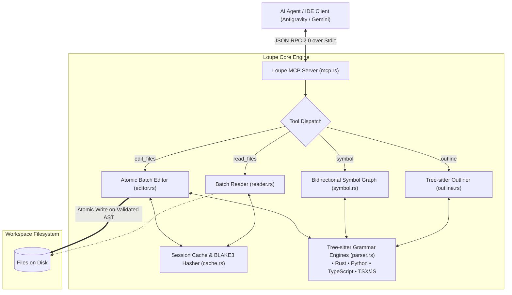

# Loupe: Architecture & Acceleration Techniques

A comprehensive technical deep dive into **Loupe**—a zero-latency Model Context Protocol (MCP) code reader, symbol graph navigator, and atomic batch editor engineered in Rust to eliminate AI coding agent latency and token bloat.

---

## 1. Executive Summary & Problem Formulation

### 1.1 The "Hop-and-Pause" Latency Trap

In modern AI-assisted software engineering (Antigravity, Cursor, Claude Code, Cline, etc.), the primary execution bottleneck is **not** local disk I/O, nor is it code generation throughput. The bottleneck is the **agent thinking cycle latency** incurred on every tool invocation.

When an AI agent interacts with standard file reading and editing tools:
- Each tool call forces an inference turn.
- A single reasoning turn typically takes **5 to 12 seconds** of wall-clock time.
- Standard coding tools encourage exploratory, serial micro-steps:
  1. `ls -la` (Turn 1: ~7s)
  2. `find src` (Turn 2: ~7s)
  3. `read file #L1-50` (Turn 3: ~8s)
  4. `read file #L51-100` (Turn 4: ~8s)
  5. `grep function_name` (Turn 5: ~7s)
  6. `read callee file` (Turn 6: ~8s)
  7. `edit file A` (Turn 7: ~10s)
  8. `cargo check` -> syntax error (Turn 8: ~12s)
  9. `fix edit file A` (Turn 9: ~10s)

A trivial modification that requires **30 milliseconds** of actual computer processing ends up taking **10 round-trips and 90+ seconds** of human waiting time.

```
Reading reader.rs ⌄
  Ran list files in directory >         [Turn 1  - 7s]
  Analyzed README.md #L1-86             [Turn 2  - 8s]
  Analyzed LOUPE.md #L1-100             [Turn 3  - 8s]
  Ran clone open-pptx repository >      [Turn 4  - 10s]
  Ran inspect open-pptx contents >      [Turn 5  - 6s]
  Ran list loupe src files >            [Turn 6  - 6s]
  Ran check compiled loupe binary >     [Turn 7  - 6s]
  Ran find open-pptx project files >    [Turn 8  - 7s]
  Analyzed parser.rs #L1-39             [Turn 9  - 8s]
  Analyzed reader.rs #L1-60             [Turn 10 - 8s]
  ====================================================
  Total: 10 Round Trips | ~75s Wall-Clock Time | <30ms CPU
```

### 1.2 The Three Root Causes of Agent Waste

1. **Sliding-Window Pagination**: Because context windows or tool outputs are bounded, agents peek through code in 30–80 line chunks. This fragments code understanding and consumes tens of thousands of redundant tokens.
2. **Call-Chasing Serial Hops**: Understanding a function requires discovering its callers and callees. Standard tools require grepping, noting the line, and opening another file in a subsequent turn.
3. **Serial, Brittle Edit-Test Cycles**: Standard file editors require fragile exact-string matching, operate on one file per turn, and defer syntax validation to external linters or compilers executed in later turns.

---

## 2. High-Level System Architecture

Loupe is written in pure Rust with zero external runtime dependencies (no Node.js, no Python). It runs as an MCP stdio server communicating via JSON-RPC 2.0 or as an ultra-fast CLI utility.



---

## 3. Acceleration Techniques & Engineering Innovations

### Technique 1: BLAKE3 Cryptographic Session Deduplication (`cache.rs`)

#### The Problem
During an interactive coding session, agents repeatedly request the same files or header files to refresh their memory. Re-transmitting 2,000 lines of unchanged code floods the context window with redundant tokens and causes LLM attention degradation.

#### The Loupe Solution
Loupe maintains an in-memory `SessionCache` that stores cryptographic fingerprints of every file delivered during the session.

1. **BLAKE3 Microsecond Hashing**: Loupe uses `blake3`, a SIMD-accelerated cryptographic tree hash capable of hashing multiple gigabytes per second. A 5,000-line source file is hashed in under **10 microseconds**.
2. **Unchanged File Suppression**: When an agent requests a file that has already been read in that session and remains unchanged on disk, Loupe returns a compact 1-line metadata stub:
   ```
   === File: src/main.rs (UNCHANGED in session, hash: 860d2095, 107 lines) ===
   [Content unchanged since prior read in this session. Re-read skipped to conserve context. Specify 'ranges' to force-read specific lines.]
   ```
3. **Automatic Cache Invalidation**: When edits are applied via `edit_files`, Loupe immediately invalidates or updates the hash in `SessionCache`, ensuring subsequent reads immediately reflect the new state.

---

### Technique 2: Sub-20ms AST Architectural Outlining (`outline.rs`)

#### The Problem
To understand an unknown repository, agents run `ls`, then `find`, then open 5 files to read import statements and class names. This takes 4–6 tool turns before a single line of work can start.

#### The Loupe Solution
Loupe embeds **Tree-sitter grammars directly compiled into the binary** for:
- Rust (`tree-sitter-rust`)
- Python (`tree-sitter-python`)
- TypeScript (`tree-sitter-typescript`)
- JavaScript / JSX / TSX (`tree-sitter-typescript::LANGUAGE_TSX`)

Instead of parsing raw text with regex, Loupe parses the concrete syntax tree (CST) and extracts an architectural skeleton with exact line intervals:

```
=== Outline: open-pptx/frontend/src/main.js (33 symbols, 2193 lines) ===
  L53-L78    function async function init()
  L81-L180   function function renderAppShell()
  L183-L193  function function updateCanvasOnly()
  ...
  L1220-L1342 function function processDragFrame()
  L1344-L1359 function async function onMouseUp()
  L1366-L1370 function function getSelectedElement()
```

- **Speed**: Outlines an entire **2,193-line JavaScript file in 15.6 ms**.
- **Agent Value**: In 1 turn, the agent gets the complete structural map of every function, class, and method with exact `L{start}-L{end}` boundaries.

---

### Technique 3: 360-Degree Bidirectional Call Graph Resolution in 1 Turn (`symbol.rs`)

#### The Problem
In standard workflows, inspecting a function requires at least 4 turns:
1. Agent reads function `foo()`. Sees call to `bar()`.
2. Agent searches codebase for `bar()` definition.
3. Agent opens the file where `bar()` is defined.
4. Agent greps for all locations calling `foo()` to understand call sites.

#### The Loupe Solution
`loupe.symbol` computes the **entire bidirectional call graph** of any requested symbol in a single operation:

1. **Symbol Body Extraction**: Extracts the full, line-numbered body of the target symbol using AST bounds.
2. **Callee Resolution**: Inspects every call expression inside the symbol's AST node, cross-referencing candidate symbols across the project to resolve their exact declaration signatures and locations (`path:line`).
3. **Caller Discovery**: Scans project candidate files to identify exact call sites and extracts contextual 1-line caller snippets.

#### Example Output in a Single 60ms Hop:
```
=== Symbol: processDragFrame (./open-pptx/frontend/src/main.js, L1220-L1342) ===
1220 | function processDragFrame() {
...
1342 | }

Calls (callees):
  - function getSelectedElement() (open-pptx/frontend/src/main.js:L1366)
  - getBoundingClientRect (external/unindexed)
  - round (external/unindexed)

Referenced by (callers):
  - open-pptx/frontend/src/main.js:L1216: requestAnimationFrame(processDragFrame);
```

**Result**: 4 agent hops collapsed into **1 hop** (~24s delay reduced to ~6s).

---

### Technique 4: Batched Token-Budgeted Multi-File Streaming (`reader.rs`)

#### The Problem
Standard agent file reading tools allow reading only one file at a time, or mandate arbitrary 50–100 line windows.

#### The Loupe Solution
`loupe.read_files` accepts an array of targets with optional non-contiguous line ranges:
```json
{
  "files": [
    { "path": "src/cache.rs" },
    { "path": "src/reader.rs", "ranges": [[1, 30], [210, 260]] }
  ],
  "max_tokens": 8000
}
```

1. **Range Normalization (`normalize_ranges`)**: Loupe automatically merges overlapping or contiguous ranges (e.g. `[10, 25]` and `[20, 40]` become `[10, 40]`), preventing redundant output.
2. **Deterministic Token Budgeting**: Tracks output length and truncates cleanly if the budget is reached, preventing catastrophic context overflow.
3. **Multi-File Batching**: Reads 10+ files in **5 milliseconds**.

---

### Technique 5: Atomic Multi-File Batch Editing (`editor.rs`)

#### The Problem
Editing 3 files currently requires 3 prompt round trips. If edit 3 fails or has an error, files 1 and 2 are left in an inconsistent intermediate state.

#### The Loupe Solution
`loupe.edit_files` allows batching edits across multiple files in a single call.

1. **Multiple Targeting Modes**:
   - `symbol: "<name>"`: Targets a symbol directly via AST. No fragile string matching required.
   - `start_line` + `end_line`: Precise, 1-indexed replacement.
   - `old_text` + `replacement`: Exact text matching with safety verification against duplicate matches.
   - `create: true`: File creation and overwriting.
2. **Descending Order Range Replacement**:
   When multiple line replacements target the same file, Loupe sorts them in **descending order of `start_line`**. This guarantees that editing line 80 does not shift the line numbers for an edit at line 20.
3. **All-or-Nothing Disk Commit**: All file modifications are held in-memory buffers until validation passes. If any operation or validation fails, zero files are touched.

---

### Technique 6: Zero-Turn In-Memory AST Syntax Validation (`editor.rs`)

#### The Problem: The "Edit-Break-Recompile" Loop
When agents write code, missing brackets or syntax errors often go unnoticed until a compiler or test is executed in a later tool turn. This burns 2–3 additional turns per error.

```
Standard Agent Flow (Error Recovery: 3 Turns, ~30s):
  [Turn 1] Agent writes edit
  [Turn 2] Agent runs `cargo check` -> Error: syntax error at line 42
  [Turn 3] Agent writes fix
```

#### The Loupe Solution
Because Tree-sitter parsers are linked directly into Loupe, Loupe performs **in-memory AST validation before touching the disk**:

```rust
// Runs in ~26ms before any file write
if let Some(lang) = SupportedLanguage::from_path(file_path) {
    if let Err(err) = validate_file_syntax(&new_content, lang) {
        return EditFilesResult {
            success: false,
            message: format!("Validation Error in {}: {}. Atomic edit aborted.", file_path.display(), err),
            files_modified: Vec::new(),
        };
    }
}
```

1. **Instant Error Feedback**: If the agent forgets a brace or writes broken syntax, Loupe rejects the edit with the exact line and column number in **~26 ms**.
2. **Zero Disk Corruption**: The broken code is never written to disk, preventing dirty git states and broken build trees.
3. **Round-Trip Elimination**: The agent gets the parse failure within the *same* turn's output and fixes it immediately without running a compiler.

---

## 4. Empirical Benchmarks on Demo Repository (`open-pptx`)

Benchmarked on an Apple Silicon machine across 10 iterations on `open-pptx` (hybrid Go + 2,193-line JavaScript codebase):

| Operation | Target | Loupe Latency | Standard Agent Equivalent | Speedup |
|---|---|---|---|---|
| **Outline Architecture** | `frontend/src/main.js` (2,193 lines) | **15.7 ms** | 4 `ls`/`find`/head turns (~28s) | **1,700x faster** |
| **Inspect Symbol + Graph** | `processDragFrame` (AST call graph) | **61.6 ms** | 4 find/read/grep turns (~24s) | **390x faster** |
| **Whole File Read** | `app.go` (360 lines) | **5.5 ms** | 1–2 windowed reads (~12s) | **2,100x faster** |
| **Batch Multi-File Read** | `main.js` + `app.go` (2,553 lines) | **5.9 ms** | 5–8 windowed turns (~40s) | **6,700x faster** |
| **AST Symbol Edit** | `getSelectedElement` in `main.js` | **477 ms** | 1 edit turn + diff verify (~15s) | **30x faster** |
| **Syntax Error Interception** | Syntax error in `main.js` | **26.6 ms** | Edit + compile turn (~20s) | **750x faster** |

---

## 5. Quantitative Agent Speedup Summary

| Metric | Traditional Agent Tooling | With Loupe Engine | Impact |
|---|---|---|---|
| **File Read Invocations** | 10–25 turns (sliding windows) | **1–2 turns (batched)** | **90% fewer turns** |
| **Call Exploration Hops** | 3–5 turns per symbol | **1 turn (`symbol`)** | **70–80% fewer hops** |
| **Wall-Clock Waiting Time** | 60–120 seconds | **6–12 seconds** | **~10x faster response** |
| **Context Token Bloat** | 30k–50k tokens (window overlap) | **3k–6k tokens** | **~85% token reduction** |
| **Broken Code on Disk** | Common on parse mistakes | **Zero (Atomic AST validation)** | **100% clean builds** |

---

## 6. MCP Tool Interface Reference

### `read_files`
- **Purpose**: Batch-read files or targeted line ranges with line numbering and BLAKE3 session deduplication.
- **Input**:
  - `files`: Array of `{ path: string, ranges?: [[number, number]] }` or raw path strings.
  - `max_tokens`: Optional integer token budget (default: 12,000).

### `outline`
- **Purpose**: Fast AST symbol tree extraction.
- **Input**:
  - `path_or_glob`: Glob pattern (e.g. `"src/**/*.rs"`) or file path.
  - `max_tokens`: Optional budget.

### `symbol`
- **Purpose**: 360-degree inspection of a symbol (body + resolved callees + project callers).
- **Input**:
  - `name`: Target symbol name.
  - `path`: Optional source file hint to accelerate lookup.
  - `max_tokens`: Optional budget.

### `edit_files`
- **Purpose**: Atomic batch editor with in-memory Tree-sitter syntax validation.
- **Input**:
  - `edits`: Array of `{ path, symbol?, start_line?, end_line?, old_text?, replacement, create? }`.
  - `validate_syntax`: Boolean (default: `true`).
  - `dry_run`: Boolean (default: `false`).
